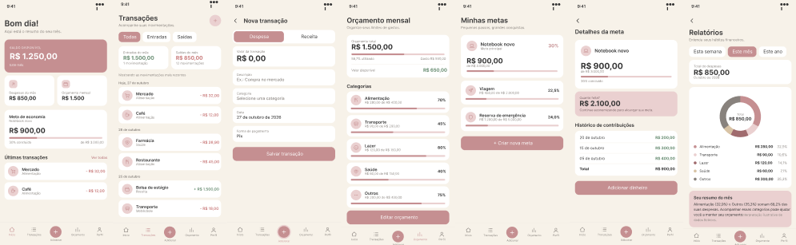
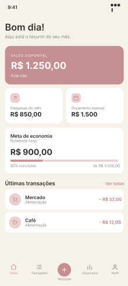
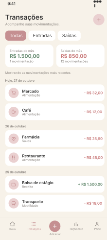
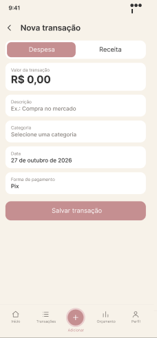
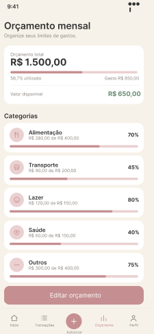
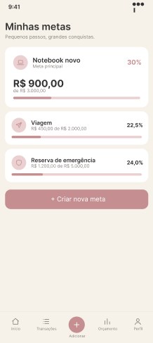
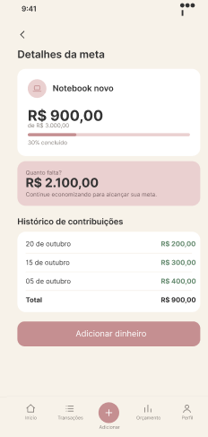
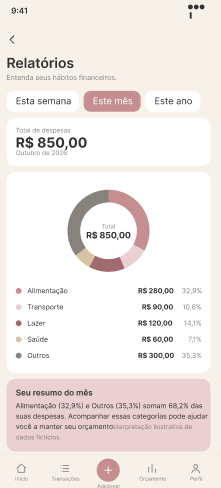

# Pocket

### Personal Finance · Mobile App Design

*A simpler way to visualize, organize, and manage personal finances.*

 

  

 

*Personal finance management through a clean and intuitive mobile interface.*

---

## 01. About the Project

**Pocket** is a personal finance mobile app design concept created in Figma.

The project explores how a clear visual hierarchy, intuitive navigation, and thoughtful information organization can help users understand their financial situation and manage their money more easily.

The interface brings together financial summaries, transaction tracking, monthly budgets, savings goals, and spending reports in a cohesive mobile experience.

## 02. The Concept

Managing personal finances involves keeping track of income, expenses, budgets, and financial goals. Pocket explores a way to bring these elements together in one accessible interface.

The design focuses on three principles:

| Principle | Design Direction |
|:--|:--|
| **Clarity** | Present financial information in an organized and easy-to-scan format. |
| **Simplicity** | Use familiar navigation patterns and straightforward screen layouts. |
| **Consistency** | Maintain cohesive colors, typography, spacing, and interface components. |

## 03. Key Screens

The project includes seven main screens, each representing a different part of the financial management experience.

### Home Dashboard

An overview of the user's financial situation, including the available balance, income and expense summaries, savings goals, and recent transactions.

### Transactions

A dedicated space to review income and expenses, explore transaction categories, and access financial activity.

### New Transaction

A form designed to organize the information needed to record a new expense or income entry.

### Monthly Budget

A visual overview of the monthly budget, including spending categories, budget limits, and progress indicators.

### Financial Goals

A screen for viewing savings goals, their target amounts, and progress toward completion.

### Goal Details

A more detailed view of an individual financial goal, including its target amount and contribution history.

### Financial Reports

A visual summary of spending patterns, with category-based breakdowns and a monthly overview.

---

## 04. Visual Identity

Pocket uses a soft, approachable visual language designed to make financial information feel organized and accessible.

| Soft Pink | Dusty Rose | Warm White |
|:---:|:---:|:---:|
|  |  |  |
| `#F4C2D7` | `#C58F91` | `#FAF7F2` |

### Design Characteristics

- **Color palette:** Soft pink and dusty rose accents paired with light, neutral backgrounds.
- **Typography:** Clear text hierarchy for financial summaries, labels, and supporting information.
- **Components:** Rounded cards, subtle dividers, and progress indicators.
- **Navigation:** A consistent bottom navigation bar across the main screens.
- **Layout:** Structured information blocks designed for mobile screens.

*The color values above are reference colors for the project's visual direction. They should be adjusted if they differ from the exact values used in the Figma file.*

## 05. Design Process

The project was developed in Figma, focusing on the organization and visual consistency of the mobile interface.

The design work explores:

- Screen layout and information hierarchy.
- Color selection and visual consistency.
- Spacing, alignment, and typography.
- Reusable interface patterns.
- Navigation between different areas of the app.
- The presentation of financial data through cards and visual indicators.

## 06. Tools & Skills

**Tools**
- Figma

**Areas explored**
- Mobile UI Design
- Visual Hierarchy
- Interface Consistency
- Information Architecture
- User Experience Principles

## 07. Project Gallery

Explore the individual screens of Pocket.

### Home Dashboard

### Transactions

### New Transaction

### Monthly Budget

### Financial Goals

### Goal Details

### Financial Reports

---

## 08. Explore the Project

Want to explore the complete design?

  

## About Me

I'm a Software Engineering student interested in Product Design, Product Management, and building digital experiences that combine usability, functionality, and thoughtful design.

I use personal and academic projects to explore new ideas, strengthen my design skills, and learn how technology can solve everyday problems.

---

**Pocket — Thoughtful design for everyday finances.**

Designed in Figma · Personal portfolio project

